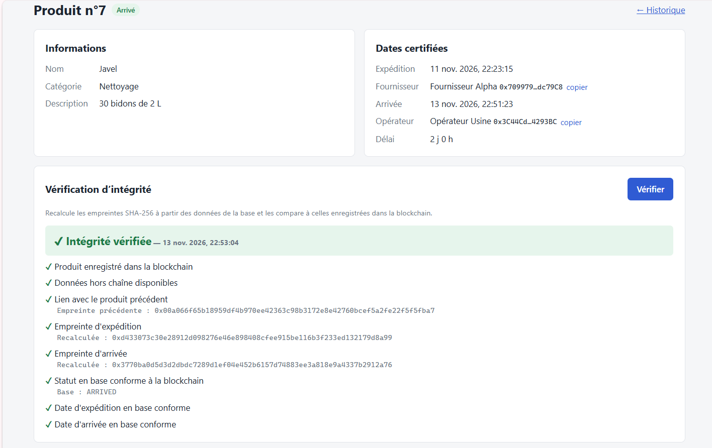

# CertiShip

Certification des dates d'expédition et d'arrivée de produits par la blockchain Ethereum.

Un fournisseur déclare l'expédition d'un produit, un opérateur de l'usine confirme sa réception. Chaque événement est horodaté on-chain et lié à une empreinte SHA-256 chaînée au produit précédent, ce qui permet de détecter toute modification ultérieure des données.



## Fonctionnement

1. Le fournisseur saisit le produit. Le backend calcule son empreinte SHA-256, qui inclut l'empreinte du produit précédent.
2. Le fournisseur signe la transaction `registerShipment` avec MetaMask. Le contrat vérifie son rôle, le numéro attendu et le chaînage, puis enregistre l'horodatage.
3. L'opérateur confirme la réception avec `confirmArrival`. Une seconde confirmation est rejetée par le contrat.
4. À tout moment, la vérification d'intégrité recalcule l'empreinte depuis la base et la compare à celle ancrée sur la blockchain.

Le backend ne détient aucune clé privée : chaque acteur signe avec son propre portefeuille, et le contrat reste la seule autorité sur les droits d'expédition et de réception. Les choix de conception sont détaillés dans [docs/ARCHITECTURE.md](docs/ARCHITECTURE.md).

## Stack technique

| Couche | Technologies |
|---|---|
| Smart contract | Solidity 0.8.24, Foundry (tests unitaires, fuzzing, invariants) |
| Backend | Node.js 22, Express, SQLite (`node:sqlite`), viem |
| Frontend | React 18, Vite, wagmi, viem |
| Réseaux | Anvil (local), Sepolia (réseau de test public) |

## Structure du dépôt

```
contracts/   Smart contract ShipmentRegistry, tests et script de déploiement Foundry
backend/     API REST : authentification, empreintes, base SQLite, synchronisation avec la chaîne
frontend/    Interface web et signature des transactions via MetaMask
scripts/     Déploiement local et Sepolia, script de falsification pour la démo
docs/        Architecture, UML, guide d'utilisation, rapport de tests, captures
```

## Démarrage en local

### Prérequis

- [Node.js](https://nodejs.org) 22.13 ou plus récent
- [Foundry](https://book.getfoundry.sh/getting-started/installation) (`forge`, `anvil`, `cast`)
- L'extension [MetaMask](https://metamask.io)

### Installation

```bash
git clone --recurse-submodules https://github.com/eyazouch/certiship-blockchain.git
cd certiship-blockchain
npm install --prefix backend
npm install --prefix frontend
```

### Lancement

Dans trois terminaux séparés :

```bash
# 1. Blockchain locale
anvil
```

```bash
# 2. Déploiement du contrat, création des comptes de démo, API
node scripts/deploy-local.mjs
cd backend && npm run seed:demo && npm start
```

```bash
# 3. Interface web
cd frontend && npm run dev
```

L'application est disponible sur http://localhost:5173.

Le script de déploiement autorise les comptes Anvil 1 et 3 comme fournisseurs et le compte 2 comme opérateur, puis renseigne `CONTRACT_ADDRESS` et `DEPLOY_BLOCK` dans `backend/.env`.

### MetaMask

Ajouter le réseau Anvil (RPC `http://127.0.0.1:8545`, chain ID `31337`, symbole `ETH`), puis importer les clés privées affichées au lancement d'`anvil`.

| Compte | Mot de passe | Compte Anvil | Rôle |
|---|---|---|---|
| `admin@demo.local` | `Admin1234!` | 0 | Administrateur |
| `fournisseur@demo.local` | `Demo1234!` | 1 | Fournisseur |
| `operateur@demo.local` | `Demo1234!` | 2 | Opérateur |
| `fournisseur2@demo.local` | `Demo1234!` | 3 | Fournisseur |

Ces identifiants et ces clés sont publics et ne doivent servir que sur Anvil. Après un redémarrage d'Anvil, si MetaMask signale une erreur de nonce : *Paramètres > Avancé > Effacer les données d'activité*.

## Tests

```bash
cd contracts && forge test -vv     # smart contract
cd contracts && forge coverage     # couverture
cd backend && npm test             # API
```

Les huit scénarios du cahier des charges sont couverts :

| Scénario | Smart contract | Backend |
|---|---|---|
| 1. Expédition valide | `test_RegisterShipment_Valid` | Test 1 |
| 2. Fournisseur non autorisé | `test_RevertWhen_UnauthorizedSupplier`, `testFuzz_RevertWhen_UnauthorizedCaller` | Test 2 |
| 3. Arrivée valide | `test_ConfirmArrival_Valid` | Test 3 |
| 4. Double confirmation | `test_RevertWhen_DoubleArrival` | Test 4 |
| 5. Produit inexistant | `test_RevertWhen_ArrivalUnknownProduct`, `testFuzz_RevertWhen_ArrivalOnUnknownId` | Test 5 |
| 6. Modification des données | hors chaîne | Test 6 |
| 7. Transactions simultanées | `test_ConcurrentShipments_SecondIsRejectedThenRetried` | Test 7 |
| 8. Panne de la base | hors chaîne | Test 8 |
| Invariants | `invariant_ChainIsContinuous`, `invariant_StatusConsistency` | |

Résultats détaillés et captures : [docs/RAPPORT_TESTS.md](docs/RAPPORT_TESTS.md).

## Déploiement sur Sepolia

Le contrat est déployé sur Sepolia à l'adresse [`0xdc5352786b8c06e56ade97ea09b8678143d99214`](https://sepolia.etherscan.io/address/0xdc5352786b8c06e56ade97ea09b8678143d99214).

La configuration Sepolia est indépendante de la démo locale (`backend/.env.sepolia`, base `backend/data/sepolia.db`) :

```bash
cp backend/.env.sepolia.example backend/.env.sepolia   # puis compléter
cast wallet import deployer --interactive
node scripts/deploy-sepolia.mjs
cd backend && npm run seed:sepolia && npm run start:sepolia
```

Le script de déploiement refuse les adresses Anvil et ne lit jamais de clé privée en clair : la signature passe par le keystore chiffré de Foundry. Procédure complète dans le [guide d'utilisation](docs/GUIDE_UTILISATION.md#11-déployer-sur-sepolia-réseau-de-test-public).

## Exigences fonctionnelles

| Réf. | Exigence | Réalisation |
|---|---|---|
| EF01 | Saisie d'un produit | Page *Nouvelle expédition*, `POST /shipments/prepare` |
| EF02 | Numéro unique et incrémental | `registerShipment` vérifie `expectedId == productCount + 1` |
| EF03 | Empreinte SHA-256 | `backend/src/hash.js` |
| EF04 | Ancrage de l'expédition | `registerShipment`, signé via MetaMask |
| EF05 | Chaînage au produit précédent | `previousHash` vérifié par le contrat et inclus dans l'empreinte |
| EF06 | Consultation par numéro | Page *Produit n°N*, recherche opérateur |
| EF07 | Vérification d'intégrité | Bouton *Vérifier*, `GET /products/:n/verify` |
| EF08 | Historique filtrable | Page *Produits* (texte, statut, catégorie, période) |
| EF09 | Gestion des acteurs autorisés | Page *Utilisateurs*, `setSupplier` / `setOperator` |
| EF10 | Suivi des transactions | Page *Transactions* (en attente, confirmée, échouée) |
| EF11 | Confirmation d'arrivée | `confirmArrival`, signé par l'opérateur |
| EF12 | Statut non modifiable | Aucune route d'écriture : le statut découle des événements on-chain |

## Documentation

- [Architecture et choix de conception](docs/ARCHITECTURE.md)
- [Diagrammes UML](docs/UML.md)
- [Guide d'utilisation](docs/GUIDE_UTILISATION.md)
- [Rapport de tests](docs/RAPPORT_TESTS.md)
- [Scénario de démonstration](docs/SCENARIO_DEMO.md)
