# Guide d'utilisation — CertiShip

Ce guide explique comment installer le projet, le lancer sur votre PC (Windows), configurer MetaMask et utiliser l'application avec chaque profil.

> **Toutes les commandes se tapent dans Git Bash**, pas dans PowerShell.
> Git Bash est installé avec Git for Windows : menu Démarrer → « Git Bash ».
> Dans PowerShell, `curl -L` et `&&` ne fonctionnent pas.

---

## 1. Installation (une seule fois)

### 1.1 Prérequis

| Outil | Vérification | Installation |
|---|---|---|
| Git for Windows | `git --version` | <https://git-scm.com> |
| Node.js ≥ 22.13 | `node -v` | <https://nodejs.org> |
| Chrome + MetaMask | — | <https://metamask.io/download> |

### 1.2 Installer Foundry (forge, anvil, cast)

Dans Git Bash :

```bash
curl -L https://foundry.paradigm.xyz | bash
```

Ajoutez Foundry au PATH (le script d'installation ne le fait pas toujours sous Windows) :

```bash
echo 'export PATH="$HOME/.foundry/bin:$PATH"' >> ~/.bash_profile
```

```bash
source ~/.bash_profile
```

```bash
foundryup
```

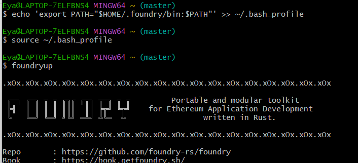

Vérifiez l'installation :

```bash
forge --version
```

### 1.3 Installer les dépendances du projet

```bash
cd "/c/Users/<votre-nom>/Desktop/Projet Blockchain"
```

```bash
cd contracts && forge install foundry-rs/forge-std && cd ..
```

```bash
cd backend && npm install && cd ..
```

```bash
cd frontend && npm install && cd ..
```

---

## 2. Configurer MetaMask (une seule fois)

### 2.1 Créer un portefeuille dédié aux tests

1. Installez MetaMask et choisissez **« Créer un nouveau portefeuille »**.
2. Choisissez un mot de passe.

> ⚠️ N'utilisez **pas** « Importer un portefeuille » avec la phrase `test test … junk` d'Anvil. Elle est publique : MetaMask synchronise alors des centaines de comptes créés par d'autres développeurs du monde entier, et la liste devient inutilisable.

### 2.2 Désactiver la synchronisation

**≡** → **Paramètres** → **Sauvegarde et synchronisation** → désactiver.

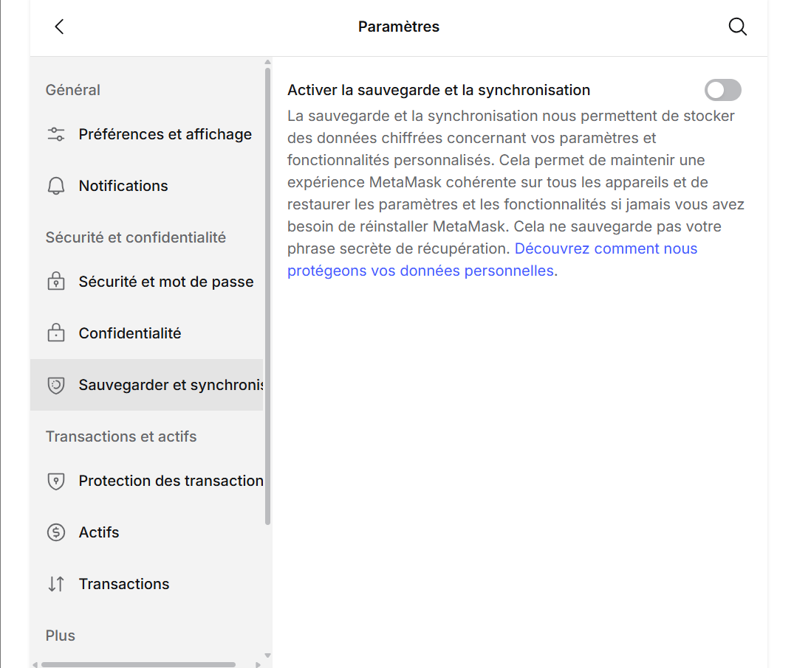

### 2.3 Importer les 4 comptes de test

Pour chaque compte : clic sur le nom du compte en haut → **Ajouter un portefeuille** → **Importer un compte** → coller la clé privée → **Importer**. Ensuite **⋮** → **Renommer**.

| Nom à donner | Clé privée | Adresse attendue |
|---|---|---|
| Admin | `0xac0974bec39a17e36ba4a6b4d238ff944bacb478cbed5efcae784d7bf4f2ff80` | `0xf39F…2266` |
| Fournisseur | `0x59c6995e998f97a5a0044966f0945389dc9e86dae88c7a8412f4603b6b78690d` | `0x7099…79C8` |
| Opérateur | `0x5de4111afa1a4b94908f83103eb1f1706367c2e68ca870fc3fb9a804cdab365a` | `0x3C44…93BC` |
| Fournisseur2 | `0x7c852118294e51e653712a81e05800f419141751be58f605c371e15141b007a6` | `0x90F7…b906` |

> Ces clés sont les comptes de test publics d'Anvil, affichés à chaque lancement. Elles ne servent **que** sur la blockchain locale. N'envoyez jamais de vrais fonds sur ces adresses.

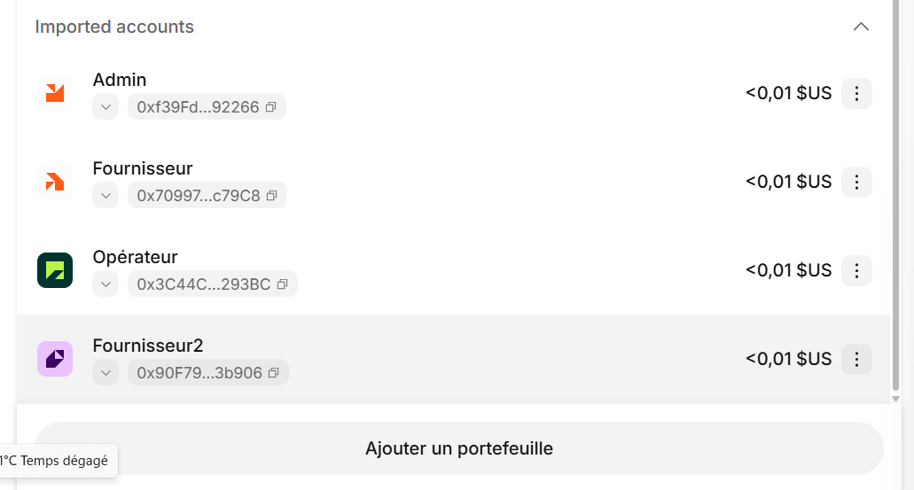

Si MetaMask répond « The account you are trying to import is a duplicate », le compte est déjà dans votre liste : cherchez-le par son adresse.

### 2.4 Ajouter le réseau Anvil

**≡** → **Réseaux** → **Ajouter un réseau personnalisé** :

| Champ | Valeur |
|---|---|
| Nom du réseau | `Anvil` |
| URL par défaut du RPC | `http://127.0.0.1:8545` |
| Identifiant de la chaîne | `31337` |
| Symbole de la devise | `ETH` |
| URL de l'explorateur de blocs | *laisser vide* |

Les avertissements orange (« GoChain Testnet », « GO ») sont normaux : l'ID 31337 est aussi utilisé par un ancien réseau public. Gardez **Anvil** et **ETH**.

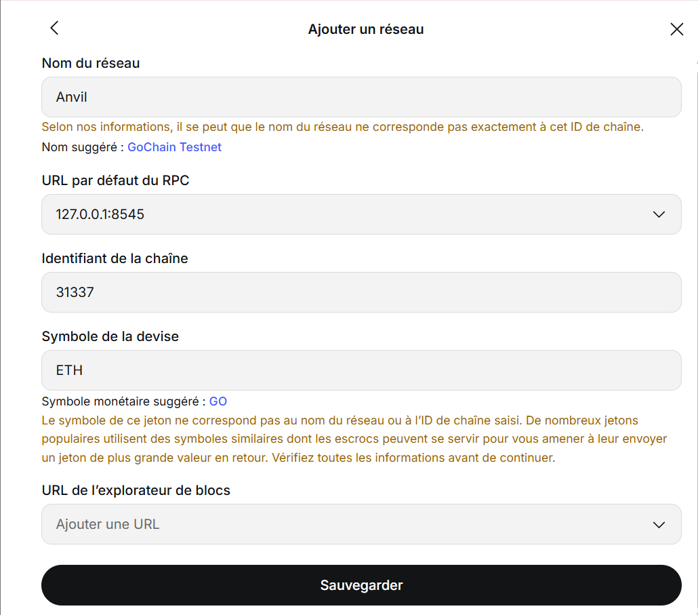

Sélectionnez le réseau **Anvil**. Une fois la blockchain lancée (§3), chaque compte affiche environ **10 000 ETH** de test.

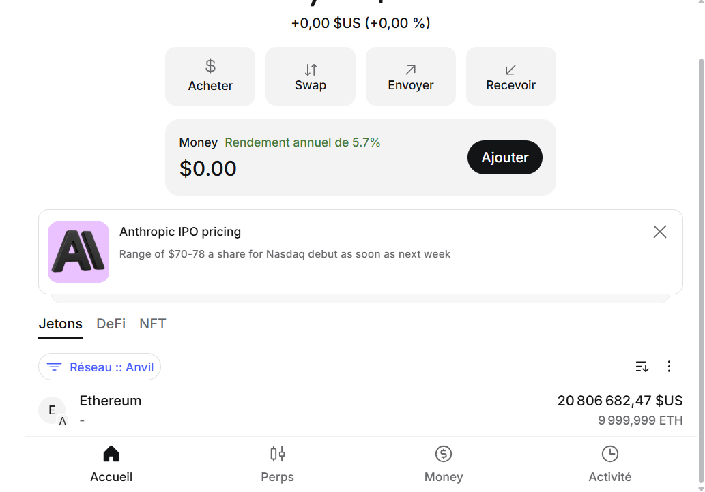

---

## 3. Lancer l'application

Il faut **3 fenêtres Git Bash** ouvertes en même temps. Dans chacune, commencez par aller dans le dossier du projet :

```bash
cd "/c/Users/<votre-nom>/Desktop/Projet Blockchain"
```

### 3.1 Premier lancement

**Fenêtre 1 — blockchain locale** (laisser ouverte) :

```bash
anvil --state anvil-state.json
```

L'option `--state` sauvegarde la blockchain dans `anvil-state.json` à la fermeture et la recharge au lancement suivant.

**Fenêtre 2 — déploiement du contrat, comptes de démo, API** :

```bash
node scripts/deploy-local.mjs
```

Ce script déploie le Smart Contract, autorise les fournisseurs et l'opérateur, puis écrit l'adresse du contrat dans `backend/.env`.

```bash
cd backend && npm run seed:demo && npm start
```

**Fenêtre 3 — interface web** :

```bash
cd frontend && npm run dev
```

Ouvrez <http://localhost:5173>.

### 3.2 Lancements suivants (en gardant les données)

> ⚠️ Ne relancez **pas** `deploy-local.mjs` ni `seed:demo` : ils repartent de zéro.

**Fenêtre 1** :

```bash
anvil --state anvil-state.json
```

**Fenêtre 2** — remettre l'horloge de la blockchain à l'heure réelle, puis lancer l'API :

```bash
cast rpc anvil_setTime $(date +%s)
```

```bash
cd backend && npm start
```

Sans `anvil_setTime`, Anvil reprend à l'heure de la dernière fermeture et les délais d'arrivée seraient faux.

**Fenêtre 3** :

```bash
cd frontend && npm run dev
```

### 3.3 Arrêter

Dans chaque fenêtre : **Ctrl + C**. Fermez Anvil avec Ctrl + C (pas avec la croix), sinon la sauvegarde n'est pas écrite.

### 3.4 Repartir de zéro

Arrêtez tout, puis :

```bash
rm -f anvil-state.json && rm -rf backend/data
```

Puis refaites le **premier lancement** (§3.1). Dans MetaMask, pour chaque compte : **≡** → **Paramètres** → **Avancé** → **Effacer les données d'activité** (sinon erreur de *nonce*).

---

## 4. Se connecter

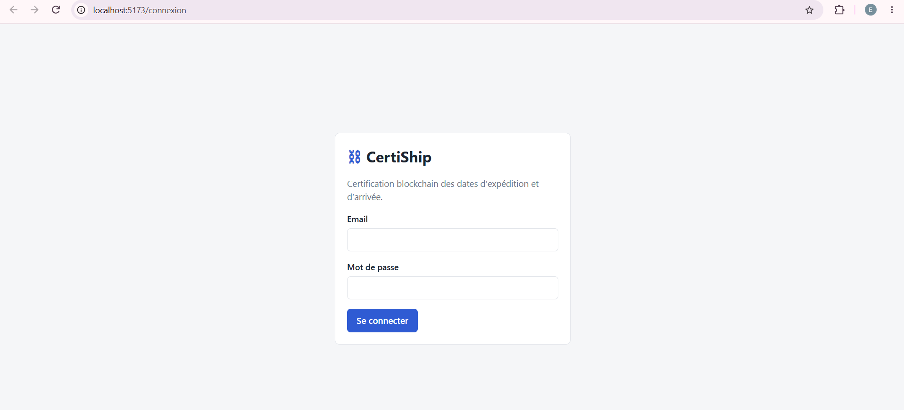

| Profil | Email | Mot de passe | Compte MetaMask à sélectionner |
|---|---|---|---|
| Administrateur | `admin@demo.local` | `Admin1234!` | Admin `0xf39F…` |
| Fournisseur Alpha | `fournisseur@demo.local` | `Demo1234!` | Fournisseur `0x7099…` |
| Fournisseur Beta | `fournisseur2@demo.local` | `Demo1234!` | Fournisseur2 `0x90F7…` |
| Opérateur Usine | `operateur@demo.local` | `Demo1234!` | Opérateur `0x3C44…` |

**Règle d'or :** le compte sélectionné dans MetaMask doit correspondre à l'utilisateur connecté dans l'application.

1. Dans MetaMask, sélectionnez le bon compte.
2. Dans l'application, connectez-vous.
3. Cliquez **Connecter MetaMask** en haut à droite et autorisez le site.
4. L'en-tête affiche « Foundry » et l'adresse du portefeuille connecté : vérifiez qu'elle est correcte.

Si vous changez d'utilisateur : **Se déconnecter** dans l'application, changez de compte dans MetaMask, reconnectez-vous.

---

## 5. Profil Fournisseur

Menu : *Tableau de bord*, *Nouvelle expédition*, *Produits*, *Transactions*.

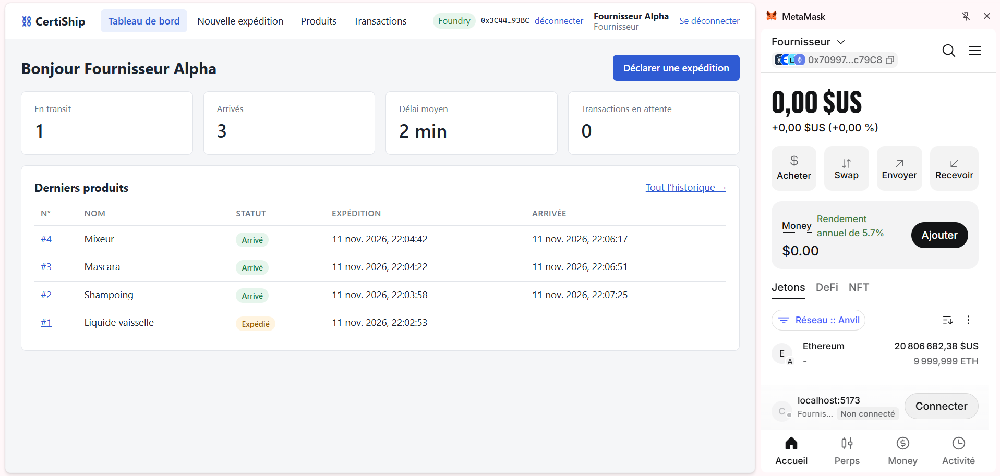

### 5.1 Déclarer une expédition

1. Cliquez **Nouvelle expédition**.
2. Remplissez **Nom du produit** et **Catégorie** (obligatoires) et **Description** (facultatif).
   Exemples : « Crème hydratante » / « Cosmétique » / « 50 pots de 200 ml ».
3. Cliquez **Déclarer l'expédition**.
4. MetaMask s'ouvre : vérifiez le réseau (**Anvil**) et le compte (**Fournisseur**), puis cliquez **Confirmer**.

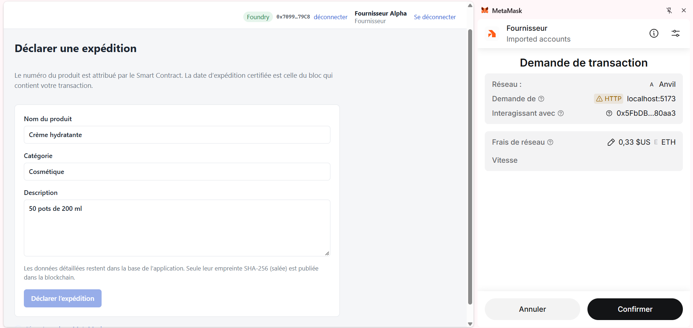

5. Un message vert confirme l'enregistrement avec le **numéro attribué par le Smart Contract** et le hash de la transaction.

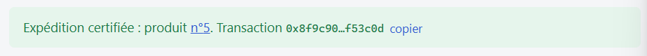

Écrivez toujours une catégorie de la même façon (par exemple « Cosmétique ») pour que le filtre par catégorie les regroupe. L'application propose les catégories déjà utilisées.

Seule une empreinte SHA-256 salée est publiée dans la blockchain. Le nom, la catégorie et la description restent dans la base de l'application.

### 5.2 Si vous refusez la signature

Si vous cliquez **Refuser** dans MetaMask, rien n'est perdu : le produit reste en **Brouillon**.

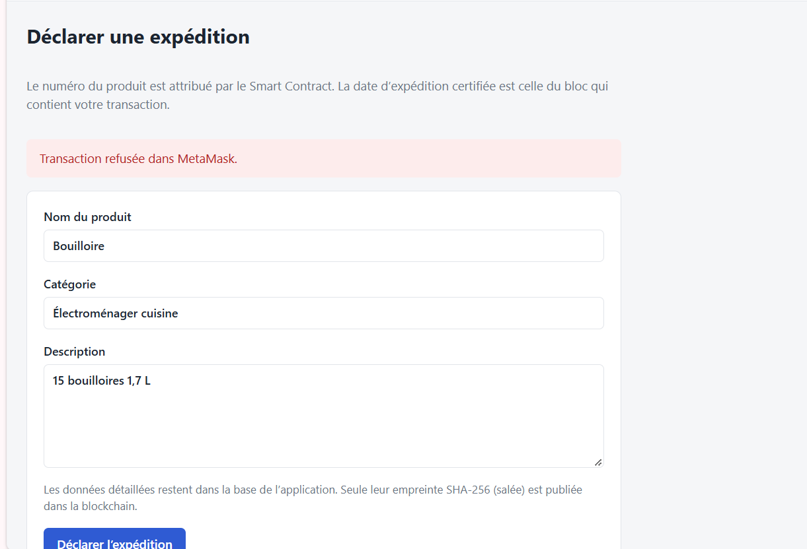

Dans **Produits**, cliquez **Finaliser** pour reprendre l'envoi, ou **Supprimer** pour l'abandonner.

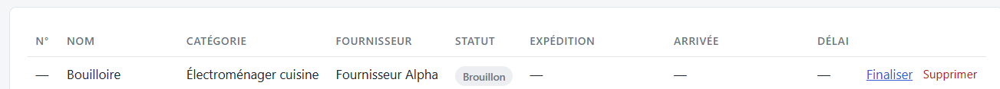

### 5.3 Consulter ses produits

La page **Produits** (« Mes produits ») liste uniquement vos produits. Vous pouvez filtrer par :

- numéro ou nom ;
- statut (Brouillon, Expédié, Arrivé) ;
- catégorie ;
- période d'expédition.

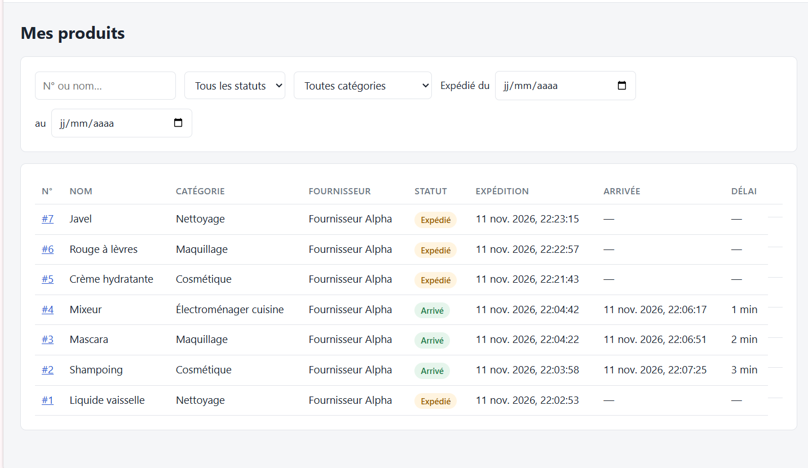

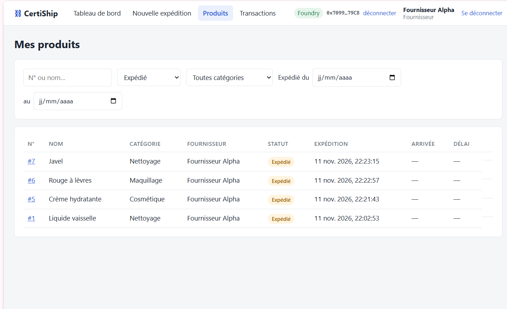

Cliquez sur un numéro (#5…) pour voir le détail, les dates certifiées, les empreintes et les transactions.

---

## 6. Profil Opérateur usine

Menu : *Tableau de bord*, *Confirmer une arrivée*, *Produits*, *Transactions*.

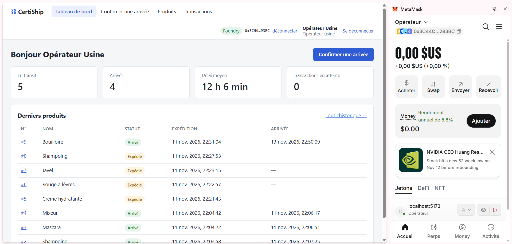

### 6.1 Confirmer l'arrivée d'un produit

1. Cliquez **Confirmer une arrivée**. La liste des **produits en transit** s'affiche.

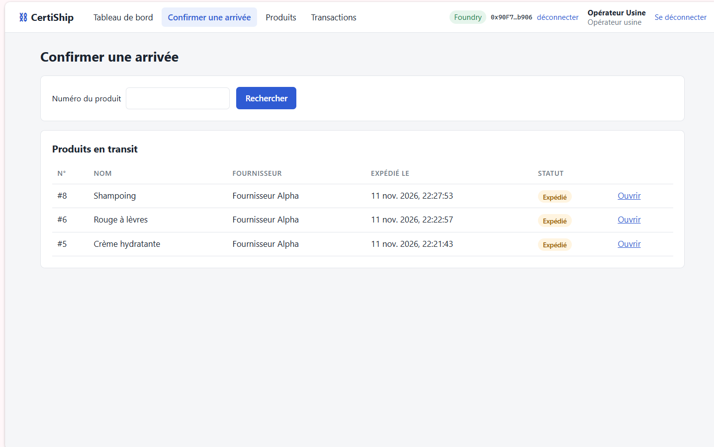

2. Saisissez le **numéro du produit** puis **Rechercher**, ou cliquez **Ouvrir** dans la liste.
3. Vérifiez les informations, puis cliquez **Confirmer l'arrivée du produit n°X**.
4. Dans MetaMask (compte **Opérateur**), cliquez **Confirmer**.

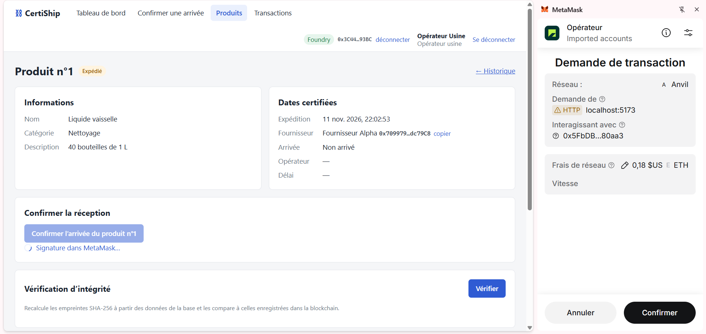

5. Le statut passe à **Arrivé** avec la date certifiée, l'opérateur et le délai depuis l'expédition.

Une arrivée ne peut être confirmée **qu'une seule fois**. Ensuite, le bouton n'apparaît plus.

### 6.2 Vérifier l'intégrité d'un produit

Sur la page d'un produit (tous les profils), cliquez **Vérifier**. L'application recalcule les empreintes à partir des données de la base et les compare à celles de la blockchain.

| Résultat | Signification |
|---|---|
| ✔ **Intégrité vérifiée** | Les données n'ont pas été modifiées depuis leur enregistrement. |
| ✘ **Intégrité non vérifiée** | Une donnée a été modifiée. La ligne en rouge indique laquelle. |

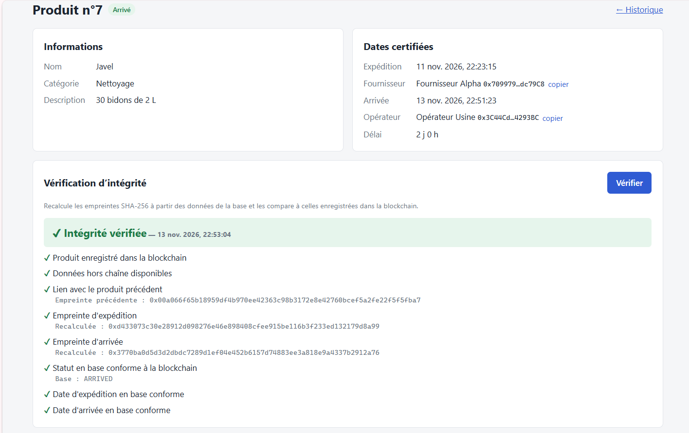

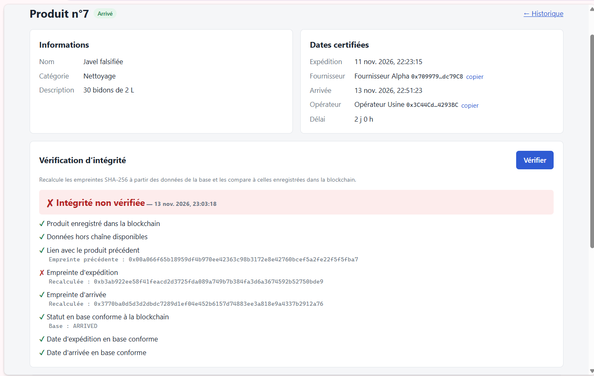

Pour la démonstration, on peut falsifier un produit directement dans la base, sans passer par l'application :

```bash
node scripts/falsifier.mjs 7 "Javel falsifiée"
```

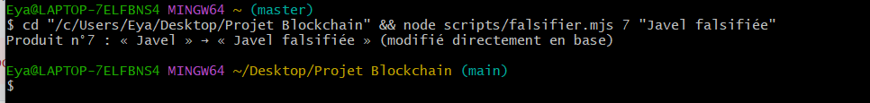

---

## 7. Profil Administrateur

Menu : *Tableau de bord*, *Produits*, *Transactions*, *Utilisateurs*. L'administrateur voit tous les produits.

### 7.1 Gérer les utilisateurs

Page **Utilisateurs** :

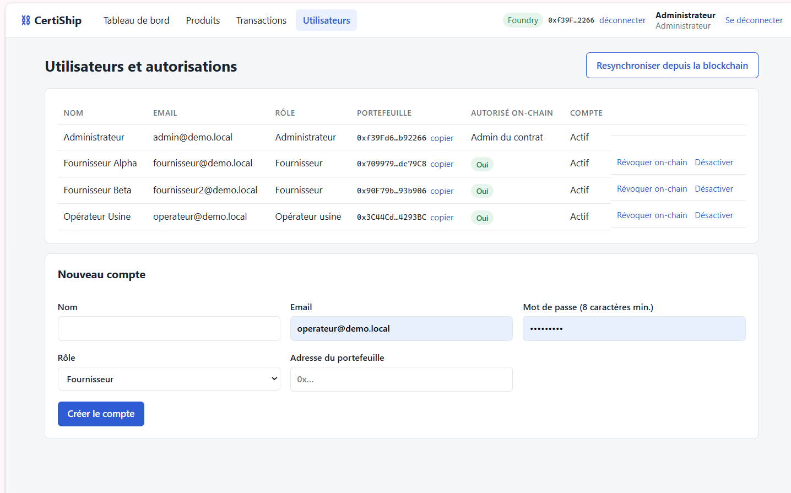

| Action | Effet | MetaMask |
|---|---|---|
| **Nouveau compte** (en bas) | Crée un compte applicatif : nom, email, mot de passe (8 caractères min.), rôle, adresse du portefeuille | non |
| **Désactiver / Réactiver** | Bloque ou rétablit la connexion à l'application | non |
| **Révoquer on-chain / Autoriser on-chain** | Retire ou donne le droit d'expédier (fournisseur) ou de confirmer (opérateur) **dans le Smart Contract** | oui, compte **Admin** |
| **Resynchroniser depuis la blockchain** | Relit les événements du contrat et met la base à jour (statuts, dates, transactions en attente) | non |

La colonne **Autorisé on-chain** indique ce que le Smart Contract autorise réellement.

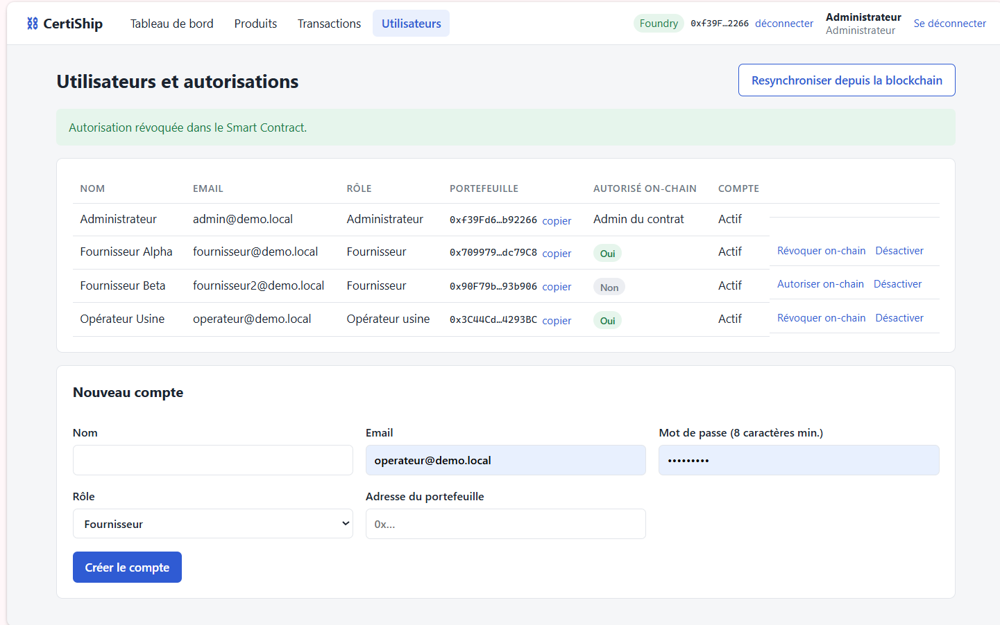

Un fournisseur révoqué ne peut plus rien expédier, même s'il peut encore se connecter à l'application :

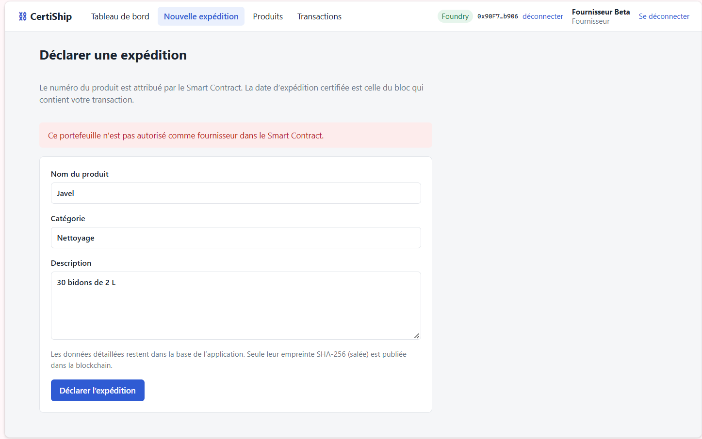

Pour créer un nouveau fournisseur ou opérateur :

1. Créez son compte avec l'adresse de son portefeuille.
2. Cliquez **Autoriser on-chain** sur sa ligne et signez avec le compte Admin.

---

## 8. Suivi des transactions

La page **Transactions** liste les opérations envoyées à la blockchain : produit, type (Expédition / Arrivée), hash, état (**En attente**, **Confirmée**, **Échouée**), numéro de bloc et adresse de l'émetteur. On peut filtrer par état et par type.

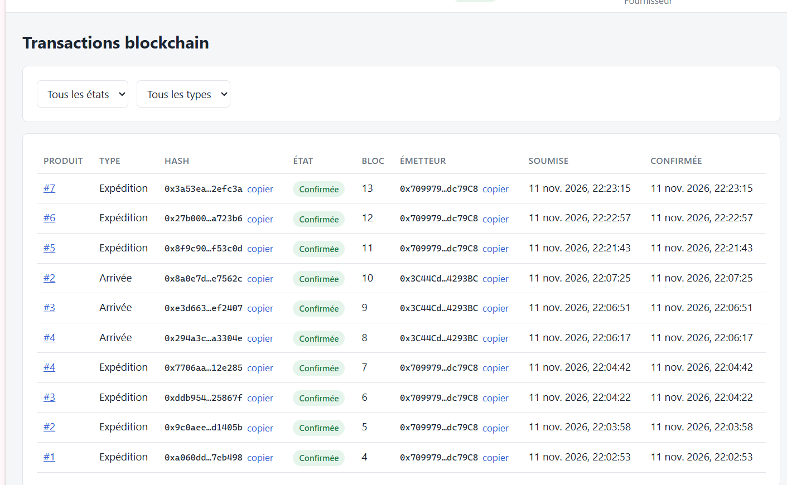

---

## 9. Messages fréquents et dépannage

| Problème | Cause | Solution |
|---|---|---|
| « Sélectionnez dans MetaMask le compte 0x… associé à votre profil » | Le compte MetaMask ne correspond pas à l'utilisateur connecté | Sélectionnez le bon compte dans MetaMask, puis **Connecter** si nécessaire |
| « Basculez MetaMask sur le réseau Foundry » | MetaMask n'est pas sur Anvil | Cliquez **Changer de réseau**, ou sélectionnez Anvil dans MetaMask |
| « Smart Contract non configuré côté serveur » | Contrat non déployé, ou API lancée avant le déploiement | Lancez `node scripts/deploy-local.mjs`, puis redémarrez l'API |
| « Ce portefeuille n'est pas autorisé comme fournisseur / opérateur » | Le compte a été révoqué dans le contrat | L'administrateur clique **Autoriser on-chain** |
| « Transaction refusée dans MetaMask » | Vous avez cliqué Refuser | Recommencez, ou **Finaliser** le brouillon |
| Erreur de *nonce* dans MetaMask | La blockchain a été réinitialisée | MetaMask → Paramètres → Avancé → **Effacer les données d'activité** (pour chaque compte) |
| Les produits ont disparu | Anvil a été relancé sans `--state`, ou fermé avec la croix | Repartez de zéro (§3.4) |
| `curl : Impossible de trouver un paramètre « L »` | Commande lancée dans PowerShell | Utilisez **Git Bash** |
| `foundryup: command not found` | Foundry absent du PATH | Refaites les commandes `echo … >> ~/.bash_profile` et `source ~/.bash_profile` (§1.2) |
| `cast wallet import … --interactive` reste bloqué sans rien afficher | Git Bash ne gère pas la saisie masquée | Ctrl + C, puis relancer précédé de `winpty` |
| `bash: $'\302\226cd': command not found` | Caractère invisible ajouté par le copier-coller | Retapez le début de la commande à la main |
| Délai d'arrivée incohérent après un redémarrage | Horloge d'Anvil non remise à l'heure | `cast rpc anvil_setTime $(date +%s)` (§3.2) |

---

## 10. Tests automatiques

```bash
cd contracts && forge test --summary
```

```bash
cd contracts && forge coverage
```

```bash
cd backend && npm test
```

Résultats attendus : 27 tests réussis côté Smart Contract, 22 côté backend. Le détail est dans le [rapport de tests](RAPPORT_TESTS.md).

---

## 11. Déployer sur Sepolia (réseau de test public)

Sepolia est un vrai réseau Ethereum public, mais son ETH n'a aucune valeur. Les transactions y sont visibles par tous sur [Etherscan](https://sepolia.etherscan.io). La configuration Sepolia est **séparée** de la démo Anvil (fichier `backend/.env.sepolia`, base `backend/data/sepolia.db`) : les deux coexistent.

> ⚠️ **N'utilisez jamais les comptes Anvil sur Sepolia.** Leurs clés sont publiques : des robots volent en quelques secondes tout ETH envoyé dessus. Le script de déploiement les refuse.

### 11.1 Préparer (une seule fois)

**1. Une URL RPC Sepolia** : créez un compte gratuit sur <https://www.alchemy.com>, puis *Create new app*, réseau **Ethereum Sepolia**. Copiez l'URL `https://eth-sepolia.g.alchemy.com/v2/…`. Ne la partagez pas : elle contient votre clé d'API.

**2. Des comptes MetaMask neufs** : dans votre portefeuille personnel (créé au §2.1), créez avec **Ajouter un compte** :

| Rôle | Compte |
|---|---|
| Administrateur (déploie le contrat) | Account 1 |
| Fournisseur | Account 2 |
| Opérateur | Account 3 |

Activez Sepolia dans MetaMask : sélecteur de réseau, **Afficher les réseaux de test**, puis **Sepolia**.

**3. De l'ETH de test** sur le compte Administrateur, avec l'un de ces faucets :

- Google Cloud Web3 Faucet : <https://cloud.google.com/application/web3/faucet/ethereum/sepolia> (compte Google, 0,05 ETH par jour) ;
- Sepolia PoW Faucet : <https://sepolia-faucet.pk910.de> (minage dans le navigateur pendant 10 à 20 min).

Envoyez ensuite environ **0,01 ETH** au Fournisseur et à l'Opérateur (MetaMask, **Envoyer**) pour qu'ils puissent payer leurs transactions.

**4. Le keystore du déployeur** : dans MetaMask, sur le compte Administrateur, **⋮**, **Détails du compte**, **Afficher la clé privée**. Puis dans Git Bash :

```bash
winpty cast wallet import deployer --interactive
```

`winpty` est indispensable dans Git Bash : sans lui, la commande reste bloquée sans rien afficher (saisie masquée). Collez la clé (clic droit → *Paste* ; rien ne s'affiche, c'est normal) et choisissez un mot de passe. Le message attendu est `` `deployer` keystore was saved successfully. Address: 0x… `` : vérifiez que c'est bien l'adresse du compte Administrateur.

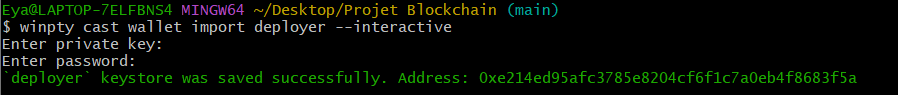 La clé est stockée **chiffrée** dans `~/.foundry/keystores/deployer`. Elle n'apparaît jamais dans le projet.

### 11.2 Configurer

```bash
cp backend/.env.sepolia.example backend/.env.sepolia
```

Ouvrez `backend/.env.sepolia` et complétez :

| Variable | Valeur |
|---|---|
| `RPC_URL` | votre URL Alchemy |
| `DEPLOYER_ADDRESS` | adresse du compte Administrateur |
| `SUPPLIERS` | adresse du Fournisseur (plusieurs adresses séparées par des virgules) |
| `OPERATORS` | adresse de l'Opérateur |
| `ADMIN_EMAIL`, `ADMIN_PASSWORD` | identifiants de l'administrateur dans l'application |

Ce fichier n'est pas commité : il reste sur votre PC.

### 11.3 Déployer

Arrêtez le backend Anvil s'il tourne (les deux utilisent le port 4000), puis :

```bash
node scripts/deploy-sepolia.mjs
```

Le script :
1. vérifie la configuration ;
2. déploie le contrat en vous demandant le mot de passe du keystore ;
3. autorise le fournisseur et l'opérateur dans le contrat ;
4. complète `backend/.env.sepolia` (adresse du contrat, bloc, secret JWT) et `frontend/.env.local` ;
5. affiche le lien Etherscan du contrat.

Dans Git Bash, lancez-le avec `winpty` pour que la saisie du mot de passe fonctionne :

```bash
winpty node scripts/deploy-sepolia.mjs
```

Si le mot de passe n'est toujours pas demandé correctement, déployez à la main, puis laissez le script relire le résultat :

```bash
cd contracts && SUPPLIERS=0x… OPERATORS=0x… forge script script/Deploy.s.sol:Deploy --rpc-url "https://eth-sepolia.g.alchemy.com/v2/…" --account deployer --sender 0xAdresseAdmin --broadcast && cd ..
```

```bash
node scripts/deploy-sepolia.mjs --from-broadcast
```

### 11.4 Lancer

```bash
cd backend && npm run seed:sepolia && npm run start:sepolia
```

`seed:sepolia` ne sert que la première fois. Ensuite, `npm run start:sepolia` suffit.

Dans une autre fenêtre (relancez-le s'il tournait déjà, pour qu'il lise `frontend/.env.local`) :

```bash
cd frontend && npm run dev
```

### 11.5 Créer les comptes et utiliser

1. Dans MetaMask, sélectionnez le réseau **Sepolia** et le compte **Administrateur**.
2. Connectez-vous avec `ADMIN_EMAIL` / `ADMIN_PASSWORD`.
3. Page **Utilisateurs** → **Nouveau compte** : créez le fournisseur et l'opérateur avec **leurs adresses MetaMask**. La colonne « Autorisé on-chain » doit afficher **Oui**, puisqu'ils ont été autorisés au déploiement.
4. Utilisez l'application exactement comme sur Anvil (§5 à §7).

Différences avec Anvil :
- une transaction met **environ 12 secondes** à être confirmée : l'application affiche l'état « En attente » pendant ce temps ;
- chaque transaction coûte un peu d'ETH de test ;
- les hash de transaction sont des **liens vers Etherscan**, où n'importe qui peut vérifier la date et l'auteur.

### 11.6 Revenir à la démo Anvil

Arrêtez le backend Sepolia (Ctrl + C), puis relancez Anvil et `npm start` comme au §3.2. Dans MetaMask, revenez sur le réseau **Anvil**.
