# Rapport de tests — CertiShip

Certification des dates d'expédition et d'arrivée de produits par la blockchain.

| | |
|---|---|
| **Période des tests** | 11 au 13 novembre 2026 |
| **Blockchain** | Anvil 1.9.0 (chaîne locale, Chain ID `31337`) |
| **Smart Contract** | `ShipmentRegistry`, Solidity 0.8.24, déployé à l'adresse `0x5FbDB2315678afecb367f032d93F642f64180aa3` |
| **Backend** | Node.js 24, Express, SQLite |
| **Frontend** | React 18, wagmi 2, viem 2, navigateur Chrome + extension MetaMask |

## 1. Stratégie de test

Les tests ont été menés sur trois niveaux complémentaires.

| Niveau | Outil | Ce qui est vérifié |
|---|---|---|
| **Smart Contract** | Foundry (`forge test`) | Règles métier exécutées dans la blockchain : rôles, numérotation, chaînage, horodatage, statuts. Tests unitaires, tests de fuzzing (valeurs aléatoires) et tests d'invariants (suites d'appels aléatoires). |
| **Backend** | `node --test` | API REST, calcul des empreintes SHA-256, vérification d'intégrité, synchronisation base ↔ blockchain. La blockchain est simulée pour pouvoir provoquer des pannes. |
| **Application complète** | Tests manuels | Parcours réels des trois profils (fournisseur, opérateur, administrateur) avec MetaMask et le contrat déployé sur Anvil. |

Les huit scénarios du cahier des charges sont couverts par au moins un de ces niveaux (voir la [synthèse](#4-synthèse-par-scénario-du-cahier-des-charges)).

## 2. Tests automatiques

### 2.1 Smart Contract — 27 tests, 27 réussis

Commande : `forge test --summary`

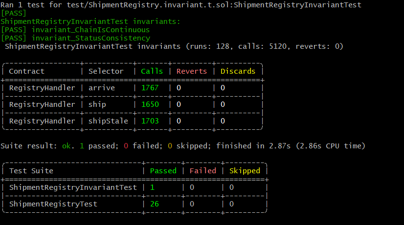

| Suite | Tests | Résultat |
|---|---|---|
| `ShipmentRegistryTest` (unitaires + fuzzing) | 26 | ✅ 26 réussis |
| `ShipmentRegistryInvariantTest` (2 invariants) | 1 | ✅ réussi |

**Tests unitaires** (20) : expédition valide, chaînage au produit précédent, fournisseur non autorisé, opérateur qui tente d'expédier, fournisseur révoqué, empreinte précédente incorrecte, empreinte nulle, empreinte réutilisée, arrivée valide, opérateur non autorisé, double confirmation, produit inexistant, expéditions simultanées, gestion des rôles réservée à l'administrateur, transfert d'administration…

**Tests de fuzzing** (6, chacun exécuté **1 000 fois** avec des valeurs aléatoires) :

| Test | Propriété vérifiée |
|---|---|
| `testFuzz_SequentialIdsAndChaining` | Quel que soit le nombre d'expéditions, les numéros se suivent et chaque produit pointe vers l'empreinte du précédent |
| `testFuzz_RevertWhen_WrongExpectedId` | Tout numéro autre que `productCount + 1` est refusé |
| `testFuzz_RevertWhen_UnauthorizedCaller` | N'importe quelle adresse non autorisée est refusée |
| `testFuzz_RevertWhen_UnauthorizedArrival` | Seul un opérateur peut confirmer une arrivée |
| `testFuzz_TimestampsComeFromBlocks` | Les dates enregistrées sont toujours celles des blocs |
| `testFuzz_RevertWhen_ArrivalOnUnknownId` | Aucune arrivée possible sur un numéro inexistant |

**Tests d'invariants** : Foundry enchaîne **5 120 appels aléatoires** (128 séries de 40) mélangeant expéditions, expéditions avec des données périmées (concurrence) et confirmations d'arrivée. Après chaque appel, il vérifie :

- `invariant_ChainIsContinuous` : les produits sont numérotés de 1 à N sans trou et chacun est chaîné au précédent ;
- `invariant_StatusConsistency` : un produit arrivé a une date d'arrivée postérieure ou égale à sa date d'expédition, un produit expédié n'a pas d'arrivée, et le nombre d'arrivées enregistrées est exact.

Résultat : 0 violation.

### 2.2 Concurrence (scénario 7)

Commande : `forge test --match-test Concurrent -vv`

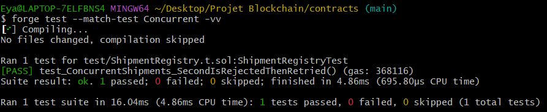

Deux fournisseurs préparent un produit en même temps et obtiennent donc le même numéro attendu. Le premier est enregistré. Le second est **refusé** par le contrat (`UnexpectedProductId`) au lieu de créer un doublon. Il est ensuite accepté avec le numéro et l'empreinte précédente recalculés.

### 2.3 Couverture du Smart Contract

Commande : `forge coverage`

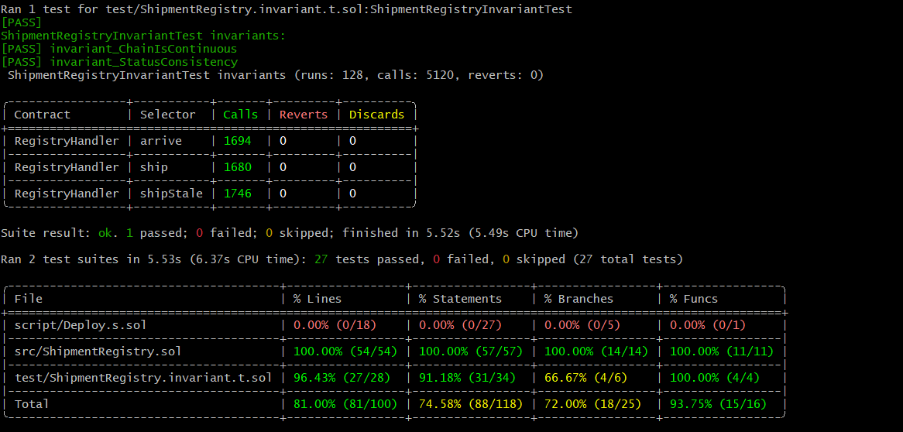

| Fichier | Lignes | Instructions | Branches | Fonctions |
|---|---|---|---|---|
| **`src/ShipmentRegistry.sol`** | **100 %** (54/54) | **100 %** (57/57) | **100 %** (14/14) | **100 %** (11/11) |

Le total affiché (81 %) inclut le script de déploiement et le fichier de test, qui ne font pas partie du code testé.

### 2.4 Backend — 22 tests, 22 réussis

Commande : `npm test`

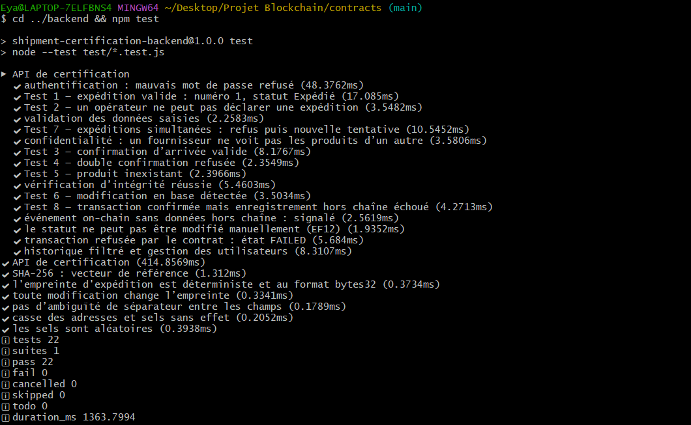

| Domaine | Tests |
|---|---|
| Scénarios du cahier des charges | Tests 1 à 8 |
| Sécurité | mauvais mot de passe refusé, un opérateur ne peut pas déclarer d'expédition, un fournisseur ne voit pas les produits d'un autre, le statut ne peut pas être modifié manuellement (EF12) |
| Données | validation des saisies, historique filtré, gestion des utilisateurs |
| Synchronisation | événement blockchain sans données hors chaîne signalé, transaction refusée par le contrat passée à l'état « échouée » |
| Empreintes SHA-256 | vecteur de référence, format `bytes32`, toute modification change l'empreinte, pas d'ambiguïté de séparateur, casse des adresses sans effet, sels aléatoires |

## 3. Tests manuels de l'application

Les tests ont été faits sur l'application complète. Chaque utilisateur signe ses transactions avec son propre compte MetaMask.

| Compte applicatif | Rôle | Portefeuille |
|---|---|---|
| Administrateur (`admin@demo.local`) | Administrateur du contrat | `0xf39F…2266` |
| Fournisseur Alpha (`fournisseur@demo.local`) | Fournisseur | `0x7099…79C8` |
| Fournisseur Beta (`fournisseur2@demo.local`) | Fournisseur | `0x90F7…b906` |
| Opérateur Usine (`operateur@demo.local`) | Opérateur usine | `0x3C44…93BC` |

Produits utilisés :

| N° | Nom | Catégorie | Description |
|---|---|---|---|
| 1 | Liquide vaisselle | Nettoyage | 40 bouteilles de 1 L |
| 2 | Shampoing | Cosmétique | 100 flacons de 250 ml |
| 3 | Mascara | Maquillage | 150 unités noires |
| 4 | Mixeur | Électroménager cuisine | 20 mixeurs 600 W |
| 5 | Crème hydratante | Cosmétique | 50 pots de 200 ml |
| 6 | Rouge à lèvres | Maquillage | — |
| 7 | Javel | Nettoyage | 30 bidons de 2 L |
| 8 | Shampoing | Cosmétique | — |
| 9 | Bouilloire | Électroménager cuisine | 15 bouilloires 1,7 L |

Les produits 1 à 9 ont été expédiés le 11 novembre. Une partie des arrivées a été confirmée le 13 novembre, pour tester un **délai réel de deux jours** entre l'expédition et l'arrivée.

---

### Scénario 1 — Expédition valide

| | |
|---|---|
| **Acteur** | Fournisseur Alpha |
| **Étapes** | 1. Ouvrir *Nouvelle expédition*. 2. Saisir « Crème hydratante », « Cosmétique », « 50 pots de 200 ml ». 3. Cliquer *Déclarer l'expédition*. 4. Confirmer dans MetaMask. |
| **Résultat attendu** | Le produit reçoit le numéro suivant, une empreinte SHA-256 et la date du bloc. Son statut est « Expédié ». |
| **Résultat obtenu** | MetaMask présente la transaction vers le contrat `0x5FbDB…80aa3` sur le réseau Anvil. Après confirmation : « Expédition certifiée : produit n°5 », avec le hash de la transaction. |
| **Statut** | ✅ Conforme |

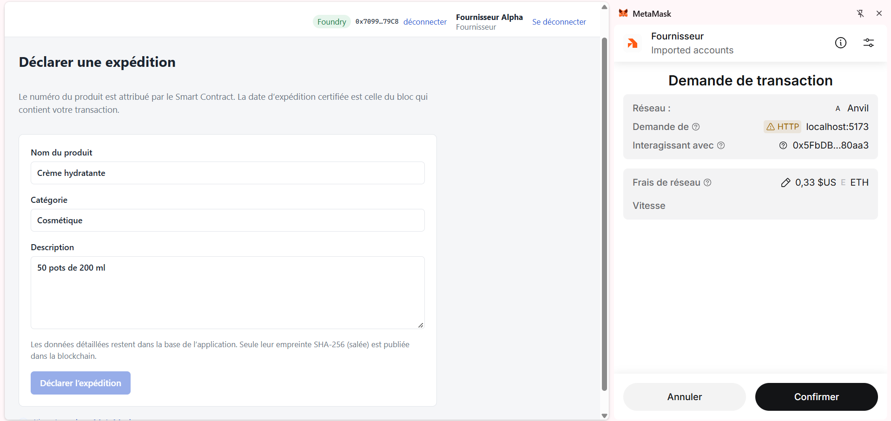

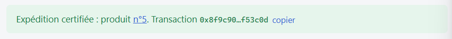

Le numéro n'est **pas** choisi par l'application : il est attribué par le Smart Contract. La date certifiée est celle du bloc qui contient la transaction.

---

### Scénario 2 — Fournisseur non autorisé

| | |
|---|---|
| **Acteurs** | Administrateur, puis Fournisseur Beta |
| **Étapes** | 1. L'administrateur ouvre *Utilisateurs* : les quatre comptes sont autorisés (« Oui »). 2. Il clique *Révoquer on-chain* sur Fournisseur Beta et signe. 3. Fournisseur Beta se connecte, saisit « Javel », « Nettoyage », « 30 bidons de 2 L » et clique *Déclarer l'expédition*. |
| **Résultat attendu** | L'expédition est refusée. |
| **Résultat obtenu** | Après la révocation, la colonne « Autorisé on-chain » passe à « Non ». La tentative de Fournisseur Beta est refusée avec le message « Ce portefeuille n'est pas autorisé comme fournisseur dans le Smart Contract. ». Le refus est détecté dès la simulation : aucune transaction n'est envoyée et aucun frais n'est payé. |
| **Statut** | ✅ Conforme |

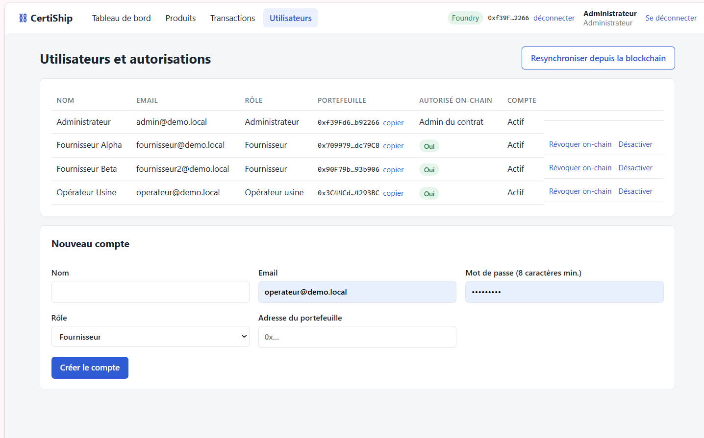

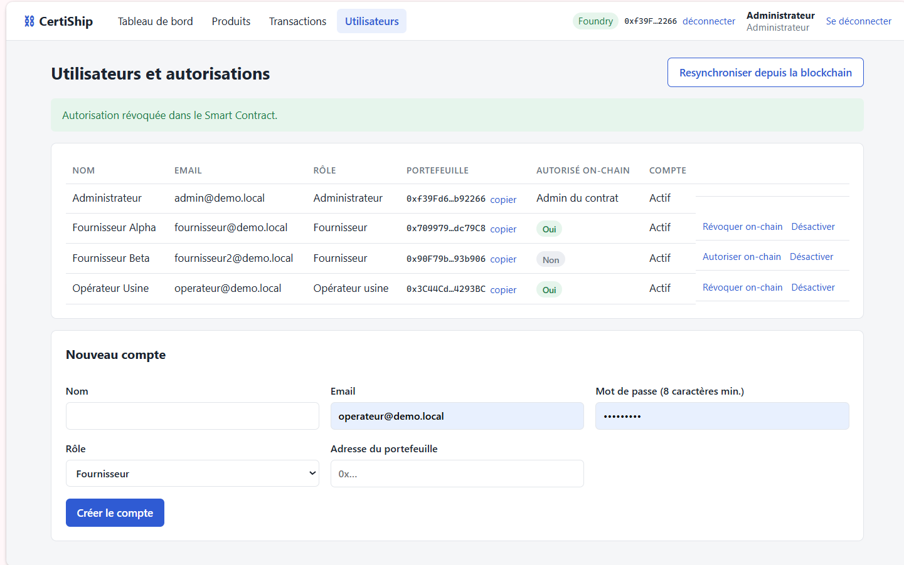

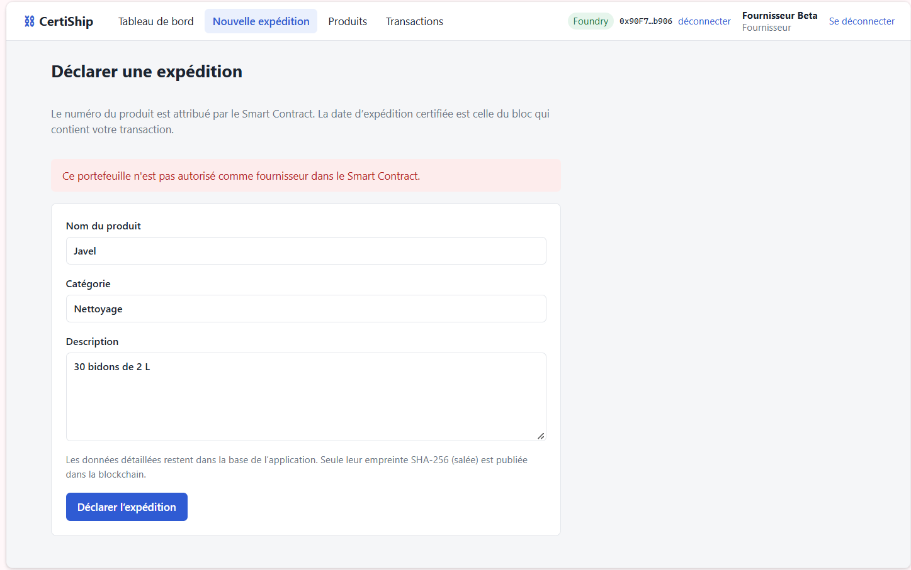

Le contrôle est fait par le Smart Contract lui-même (erreur `NotSupplier`). Même un utilisateur qui contournerait l'interface ne pourrait pas enregistrer d'expédition.

---

### Scénario 3 — Confirmation d'arrivée valide

| | |
|---|---|
| **Acteur** | Opérateur Usine |
| **Étapes** | 1. Ouvrir *Confirmer une arrivée* : la liste des produits en transit s'affiche. 2. Ouvrir un produit expédié. 3. Cliquer *Confirmer l'arrivée du produit n°X*. 4. Signer dans MetaMask. |
| **Résultat attendu** | Le statut passe à « Arrivé », avec la date du bloc et l'adresse de l'opérateur. |
| **Résultat obtenu** | Produit n°7 (Javel), expédié le 11 nov. 2026 à 22:23:15 et arrivé le 13 nov. 2026 à 22:51:23. L'opérateur est enregistré et le délai calculé est de **2 j 0 h**. |
| **Statut** | ✅ Conforme |

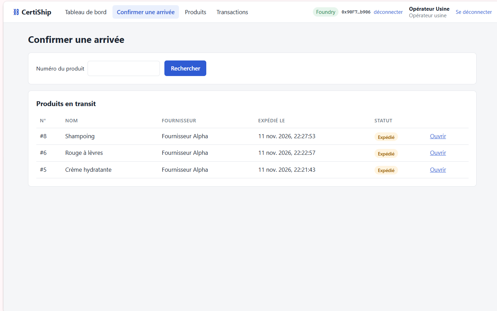

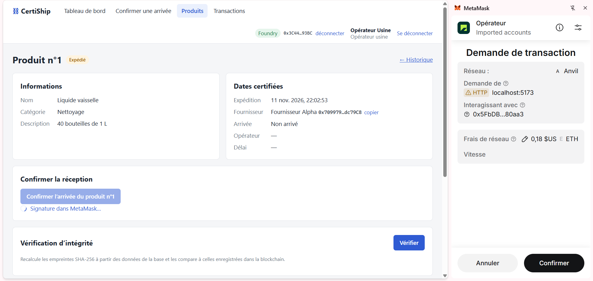

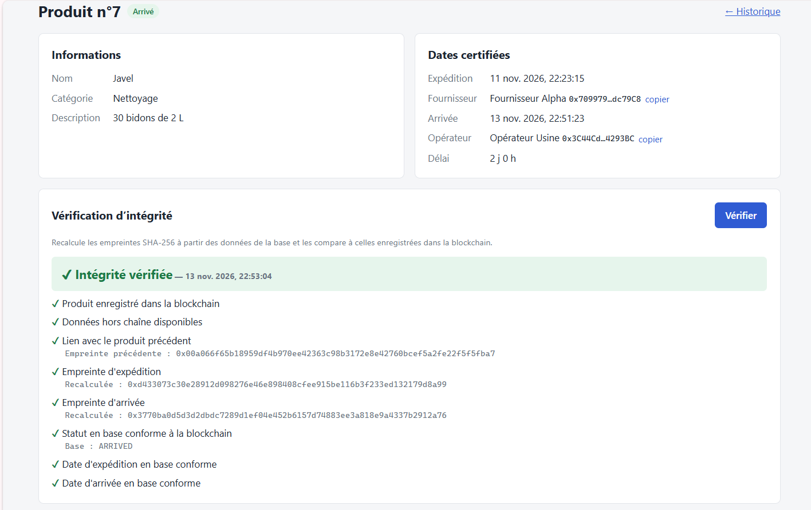

---

### Scénario 4 — Double confirmation

| | |
|---|---|
| **Acteur** | Opérateur Usine |
| **Étapes** | Rouvrir un produit déjà arrivé (n°7). |
| **Résultat attendu** | Une seconde confirmation est impossible. |
| **Résultat obtenu** | Interface : la section « Confirmer la réception » n'apparaît plus sur un produit arrivé (capture ci-dessus). Contrat : `test_RevertWhen_DoubleArrival` vérifie qu'un second appel à `confirmArrival` est refusé (`AlreadyArrived`). Backend : « Test 4 — double confirmation refusée ». |
| **Statut** | ✅ Conforme |

---

### Scénario 5 — Produit inexistant

| | |
|---|---|
| **Résultat attendu** | Une confirmation d'arrivée sur un numéro inexistant est refusée. |
| **Résultat obtenu** | Vérifié par les tests automatiques : `test_RevertWhen_ArrivalUnknownProduct`, `testFuzz_RevertWhen_ArrivalOnUnknownId` (1 000 numéros aléatoires) et le « Test 5 » du backend. |
| **Statut** | ✅ Conforme (tests automatiques, pas de capture de l'interface) |

---

### Scénario 6 — Modification des données

| | |
|---|---|
| **Étapes** | 1. Sur le produit n°7, cliquer *Vérifier* : intégrité vérifiée. 2. Modifier le nom directement dans la base de données, sans passer par l'application : `node scripts/falsifier.mjs 7 "Javel falsifiée"`. 3. Rouvrir le produit et cliquer de nouveau sur *Vérifier*. |
| **Résultat attendu** | La modification est détectée. |
| **Résultat obtenu** | **Avant** : « ✔ Intégrité vérifiée », les 8 contrôles sont au vert. **Après** : « ✘ Intégrité non vérifiée ». Seul le contrôle « Empreinte d'expédition » échoue : l'empreinte recalculée à partir des données modifiées ne correspond plus à celle enregistrée dans la blockchain. Les autres contrôles (chaînage, empreinte d'arrivée, statut, dates) restent valides, ce qui localise précisément la falsification. |
| **Statut** | ✅ Conforme |

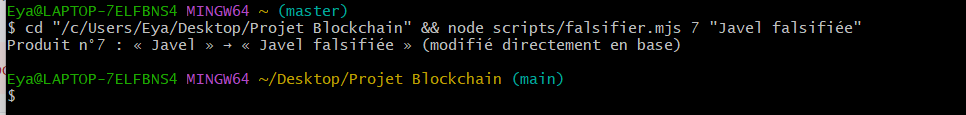

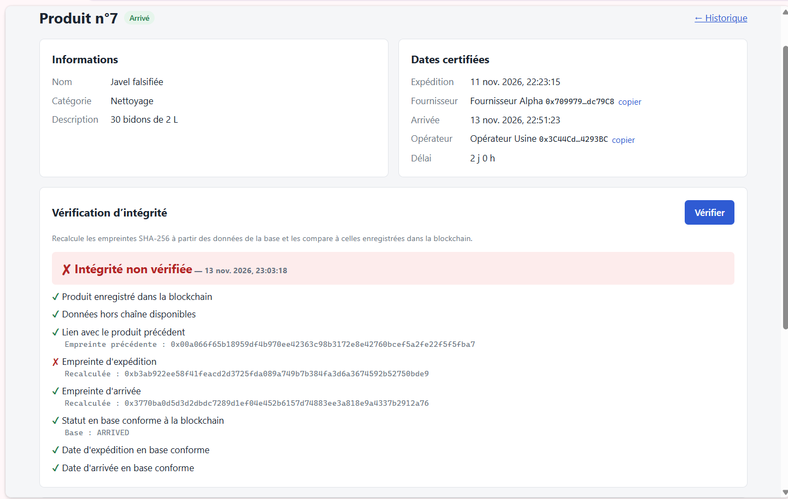

Contrôles effectués par la vérification :

1. le produit existe dans la blockchain ;
2. les données hors chaîne sont disponibles ;
3. le lien avec le produit précédent est intact ;
4. l'empreinte d'expédition recalculée est identique à celle de la blockchain ;
5. l'empreinte d'arrivée recalculée est identique ;
6. le statut en base est conforme à la blockchain ;
7. la date d'expédition en base est conforme ;
8. la date d'arrivée en base est conforme.

---

### Scénario 7 — Transactions simultanées

| | |
|---|---|
| **Résultat attendu** | Deux expéditions simultanées ne produisent ni doublon de numéro ni chaînage cassé. |
| **Résultat obtenu** | Vérifié par `test_ConcurrentShipments_SecondIsRejectedThenRetried` (§2.2), par le « Test 7 » du backend, et par l'invariant `invariant_ChainIsContinuous` qui mélange 1 700 envois périmés à des envois valides sans aucune incohérence. Côté interface, en cas de refus `UnexpectedProductId` ou `PreviousHashMismatch`, le frontend demande au backend de recalculer l'empreinte et réessaie automatiquement (jusqu'à 3 fois). |
| **Statut** | ✅ Conforme (tests automatiques ; difficile à reproduire à la main avec un seul navigateur) |

---

### Scénario 8 — Échec de l'enregistrement en base

| | |
|---|---|
| **Résultat attendu** | Si la transaction est confirmée dans la blockchain mais que la base n'est pas mise à jour, l'application retrouve un état cohérent. |
| **Résultat obtenu** | Vérifié par le « Test 8 » du backend : une expédition confirmée dans la blockchain mais jamais enregistrée en base est récupérée par l'indexeur, qui relit les événements `ShipmentRegistered`. Le produit passe à « Expédié » avec le bon numéro et la bonne date. Le brouillon et son sel étant enregistrés **avant** l'envoi de la transaction, aucune donnée n'est perdue. |
| **Statut** | ✅ Conforme (test automatique, pas de capture de l'interface) |

---

### Tests complémentaires

#### Mauvais compte MetaMask

Un utilisateur connecté en Fournisseur Alpha a sélectionné le compte Opérateur dans MetaMask. L'application bloque l'envoi et affiche : « Sélectionnez dans MetaMask le compte 0x7099…79C8 associé à votre profil. ». Le bouton *Déclarer l'expédition* reste désactivé. ✅

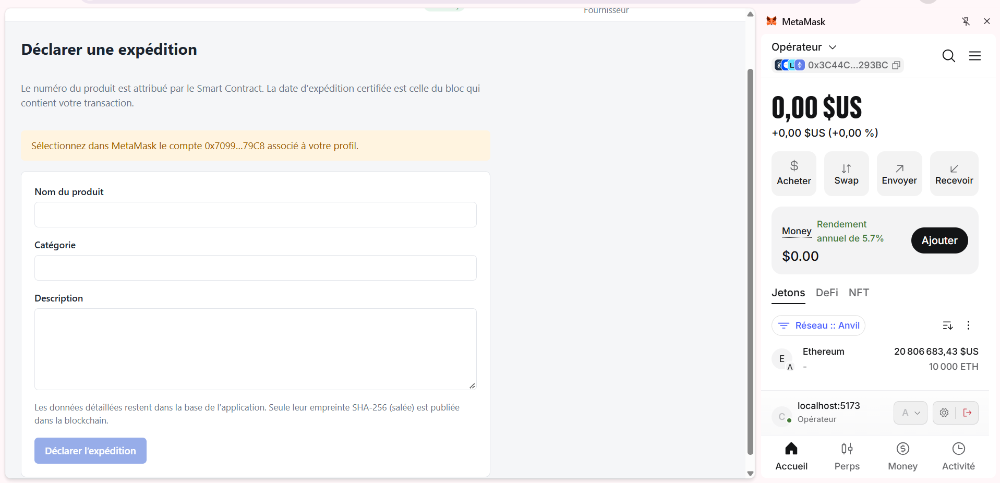

Ce contrôle garantit que l'auteur enregistré dans la blockchain est bien l'acteur connecté à l'application.

#### Refus de signature et reprise du brouillon

1. Le fournisseur déclare « Bouilloire » puis clique *Refuser* dans MetaMask : « Transaction refusée dans MetaMask. »
2. Le produit est conservé en **Brouillon**, sans numéro, avec les actions *Finaliser* et *Supprimer*.
3. Après *Finaliser* et signature, il est enregistré sous le n°9.

✅ Aucune saisie n'est perdue, et aucun numéro n'est consommé tant que la transaction n'est pas confirmée.

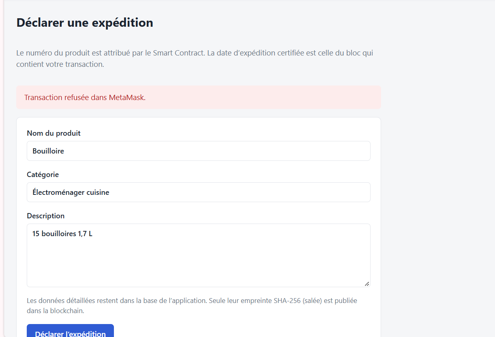

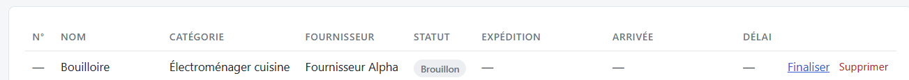

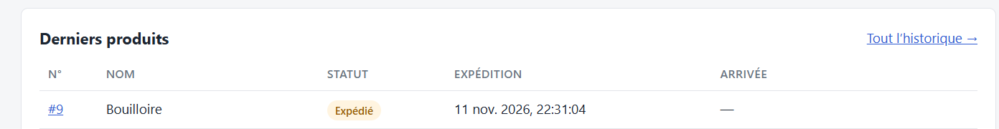

#### Historique, filtres et suivi des transactions

- La page *Mes produits* liste les produits du fournisseur avec leur catégorie, leur statut, leurs dates et leur délai. Le filtre « Expédié » ne garde que les produits en transit. ✅
- La page *Transactions blockchain* affiche pour chaque opération : produit, type (Expédition / Arrivée), hash, état « Confirmée », numéro de bloc et émetteur. On vérifie que les arrivées sont émises par `0x3C44…` (Opérateur) et les expéditions par `0x7099…` (Fournisseur). ✅
- Le tableau de bord indique les produits en transit, arrivés, le délai moyen et les transactions en attente. ✅

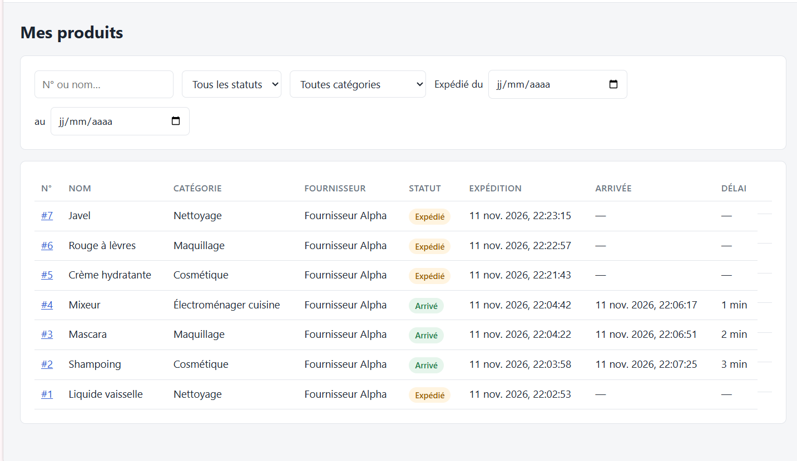

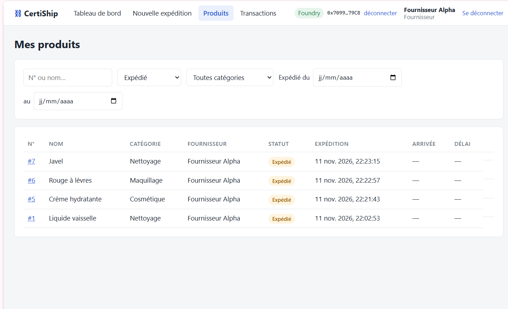

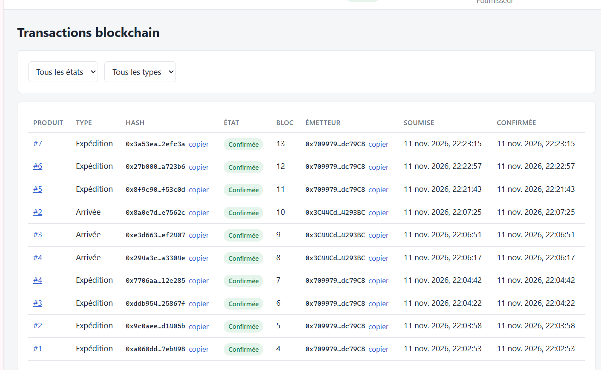

## 4. Synthèse par scénario du cahier des charges

| # | Scénario | Smart Contract | Backend | Application | Résultat |
|---|---|---|---|---|---|
| 1 | Expédition valide | ✅ | ✅ | ✅ capture | **Conforme** |
| 2 | Fournisseur non autorisé | ✅ + fuzzing | ✅ | ✅ capture | **Conforme** |
| 3 | Arrivée valide | ✅ | ✅ | ✅ capture | **Conforme** |
| 4 | Double confirmation | ✅ | ✅ | ✅ capture | **Conforme** |
| 5 | Produit inexistant | ✅ + fuzzing | ✅ | — | **Conforme** |
| 6 | Modification des données | hors chaîne | ✅ | ✅ capture | **Conforme** |
| 7 | Transactions simultanées | ✅ + invariants | ✅ | — | **Conforme** |
| 8 | Échec de la base | hors chaîne | ✅ | — | **Conforme** |

## 5. Exigences fonctionnelles

| Réf. | Exigence | Preuve |
|---|---|---|
| EF01 | Saisir un produit | Scénario 1 |
| EF02 | Numéro unique et incrémental | Scénario 1, fuzzing `SequentialIdsAndChaining`, invariants |
| EF03 | Empreinte SHA-256 | Tests SHA-256 du backend, page produit |
| EF04 | Ancrage de l'expédition | Scénario 1, page Transactions |
| EF05 | Chaînage au produit précédent | Contrôle « Lien avec le produit précédent », invariant `ChainIsContinuous` |
| EF06 | Consultation par numéro | Scénario 3 (recherche opérateur) |
| EF07 | Vérification d'intégrité | Scénario 6 |
| EF08 | Historique avec filtres | Tests complémentaires |
| EF09 | Gestion des acteurs autorisés | Scénario 2 |
| EF10 | Suivi des transactions | Page Transactions |
| EF11 | Confirmation d'arrivée | Scénario 3 |
| EF12 | Statut non modifiable | Test backend « le statut ne peut pas être modifié manuellement » ; aucune interface ne permet de saisir un statut |

## 6. Bilan

- **49 tests automatiques** (27 Smart Contract + 22 backend), tous réussis.
- **100 %** de couverture du Smart Contract (lignes, branches et fonctions).
- Les **8 scénarios** du cahier des charges sont conformes ; 5 d'entre eux sont aussi illustrés par des captures de l'application réelle.

### Limites des tests

- Les scénarios 5, 7 et 8 n'ont été vérifiés que par des tests automatiques, pas par une manipulation dans l'interface.
- Les tests ont été réalisés sur Anvil (blockchain locale). Le déploiement sur le réseau de test public Sepolia est documenté mais n'a pas été testé.
- Le frontend n'a pas de tests automatiques ; il a été validé par les tests manuels ci-dessus.
- Sur Anvil, les blocs sont minés instantanément. Sur un réseau public, la confirmation prend environ 12 secondes et l'application affiche alors l'état « en attente ».
