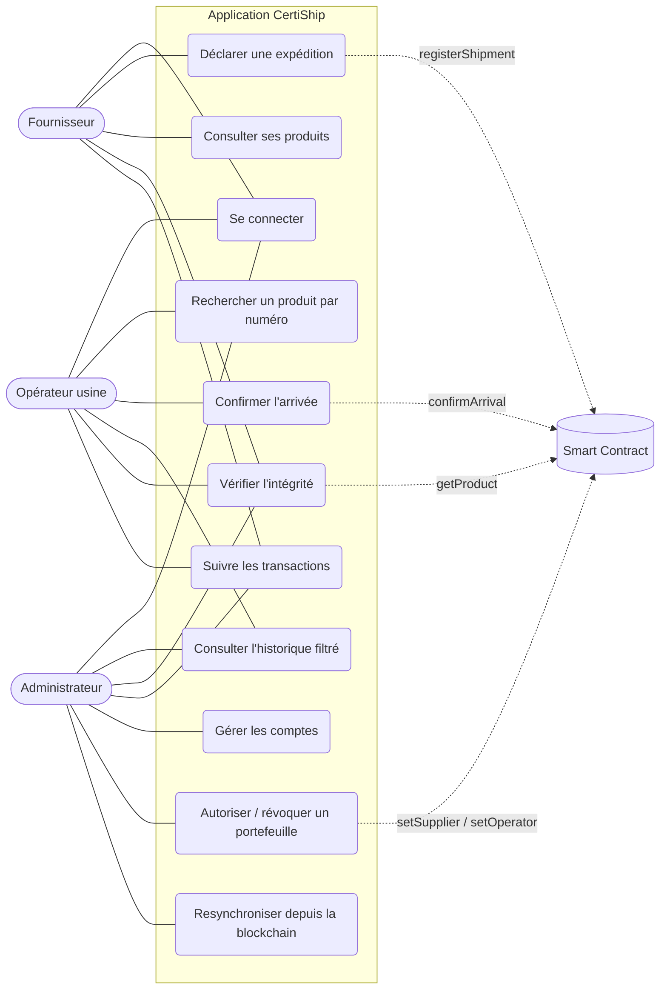
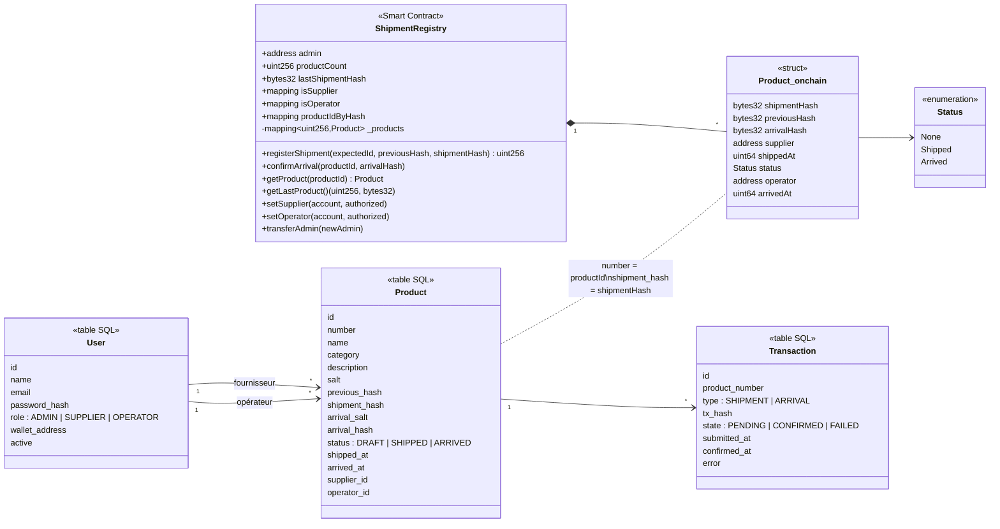
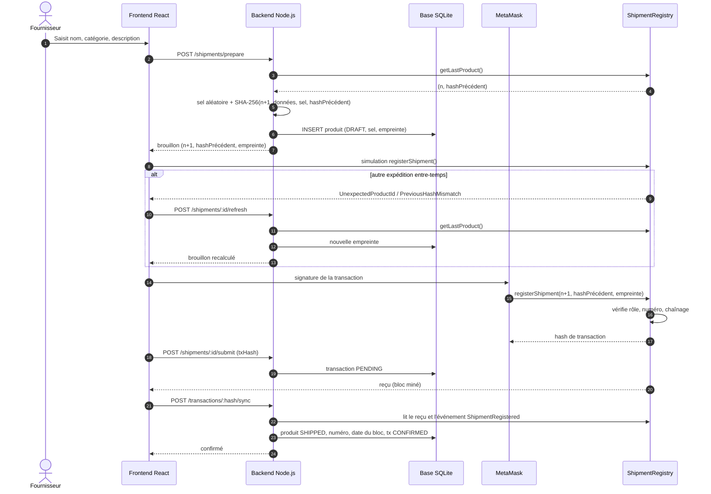
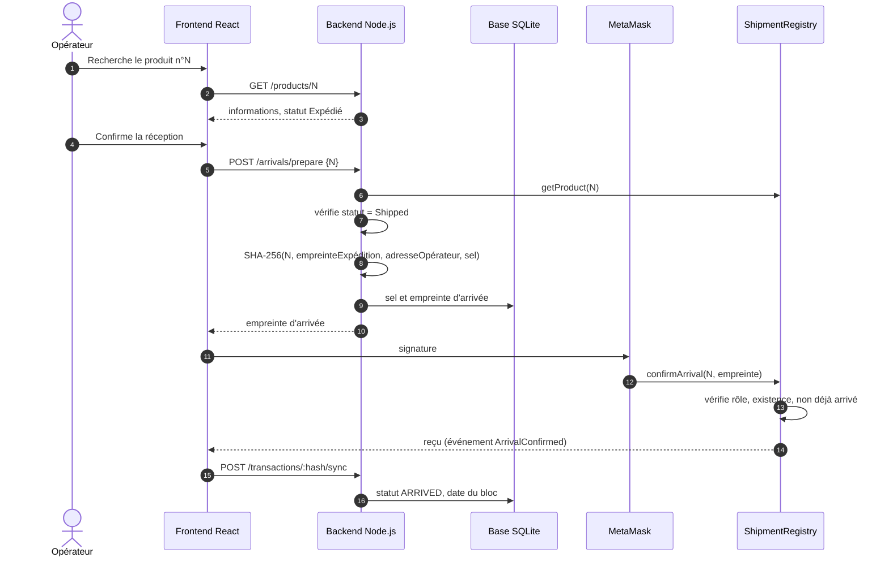
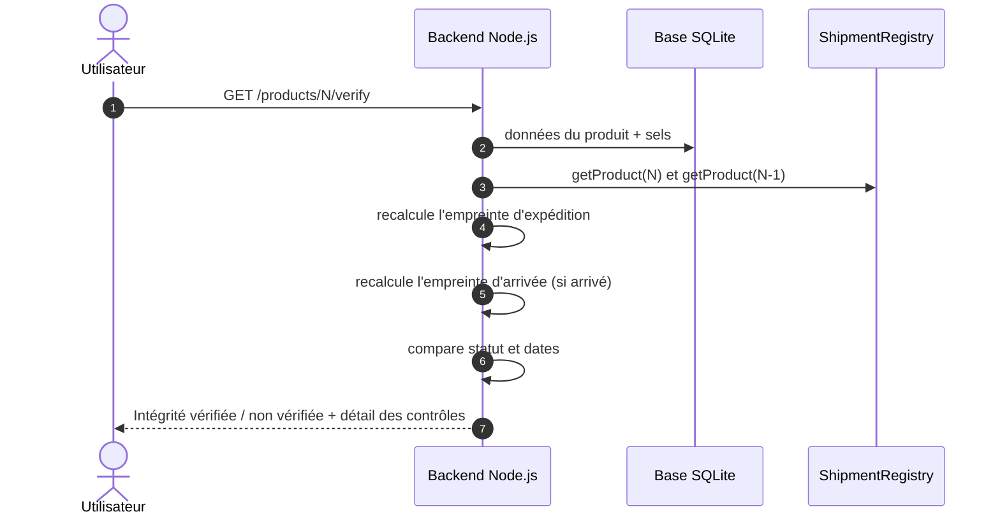
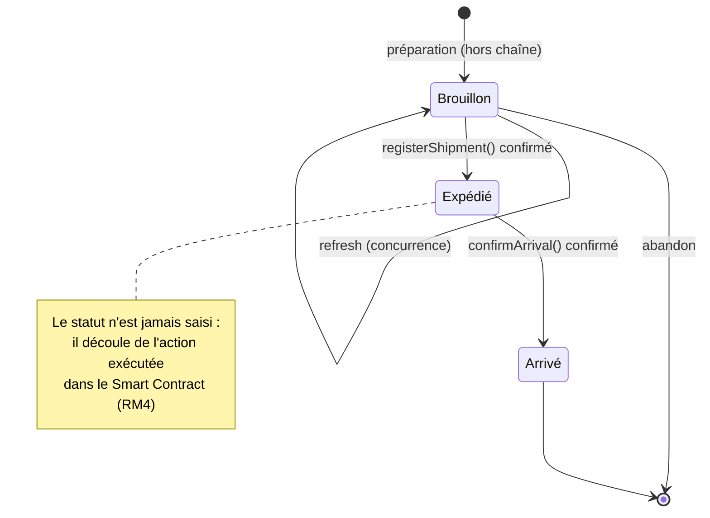
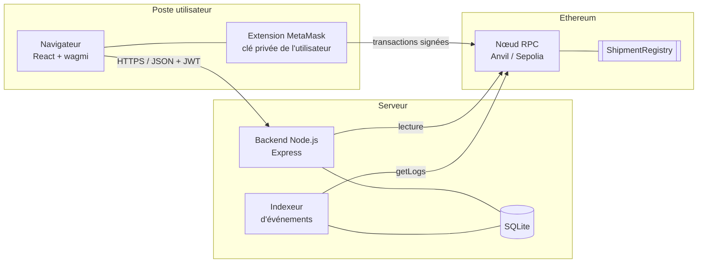

# Diagrammes UML

Les diagrammes sont écrits en [Mermaid](https://mermaid.js.org/). GitHub, GitLab et VS Code (extension *Markdown Preview Mermaid Support*) les affichent directement. Pour les exporter en image : <https://mermaid.live>.

## 1. Diagramme de cas d'utilisation

## 2. Diagramme de classes

## 3. Diagramme de séquence — Déclaration de l'expédition

## 4. Diagramme de séquence — Confirmation de l'arrivée

## 5. Diagramme de séquence — Vérification de l'intégrité

## 6. Diagramme d'états — Produit

## 7. Diagramme de déploiement

